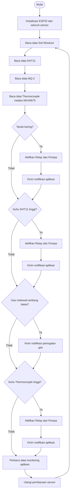
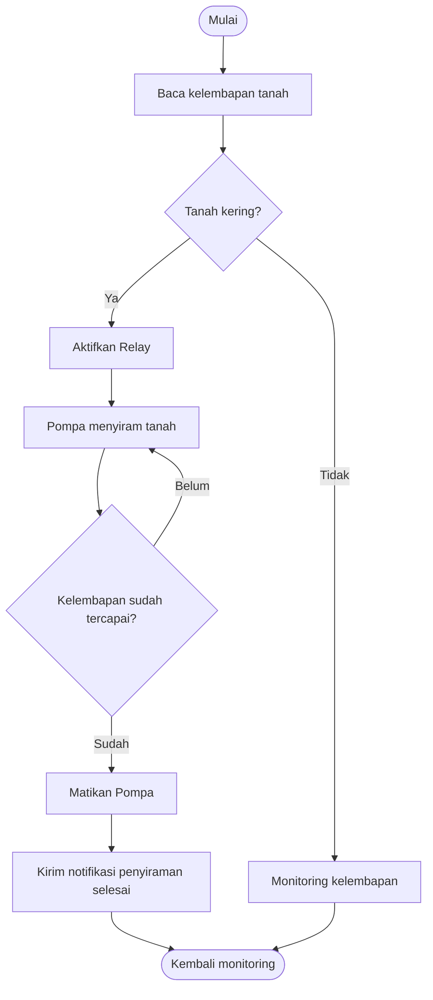
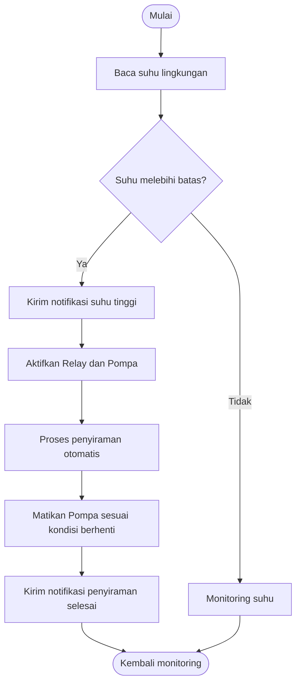
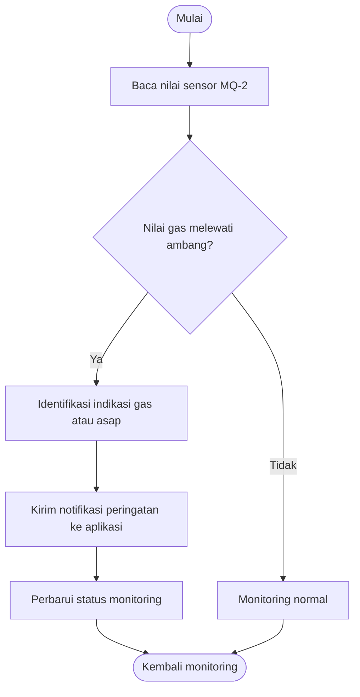
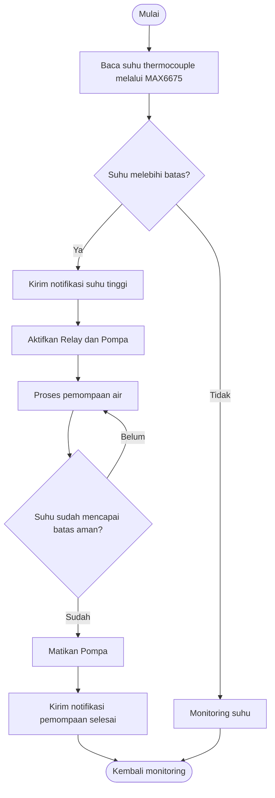

# FLOWCHART SISTEM IoT

## 1. Flowchart Utama

## 2. Flowchart Soil Moisture

## 3. Flowchart DHT11

## 4. Flowchart MQ-2

## 5. Flowchart Thermocouple

## 6. Keterangan Simbol

| Simbol | Keterangan |
|---|---|
| Oval | Mulai atau selesai |
| Persegi panjang | Proses atau aktivitas |
| Belah ketupat | Keputusan atau kondisi |
| Panah | Arah alur proses |

## 7. Keterangan Sistem

- ESP32 berfungsi sebagai pusat kendali seluruh perangkat.
- Soil Moisture mendeteksi kondisi kelembapan tanah.
- DHT11 memantau suhu dan kelembapan udara.
- MQ-2 mendeteksi indikasi gas atau asap.
- Thermocouple mengukur suhu pada titik pemasangan.
- Relay mengendalikan pompa air.
- Aplikasi menerima notifikasi dari seluruh sensor.
- Proses monitoring berlangsung secara berulang.
