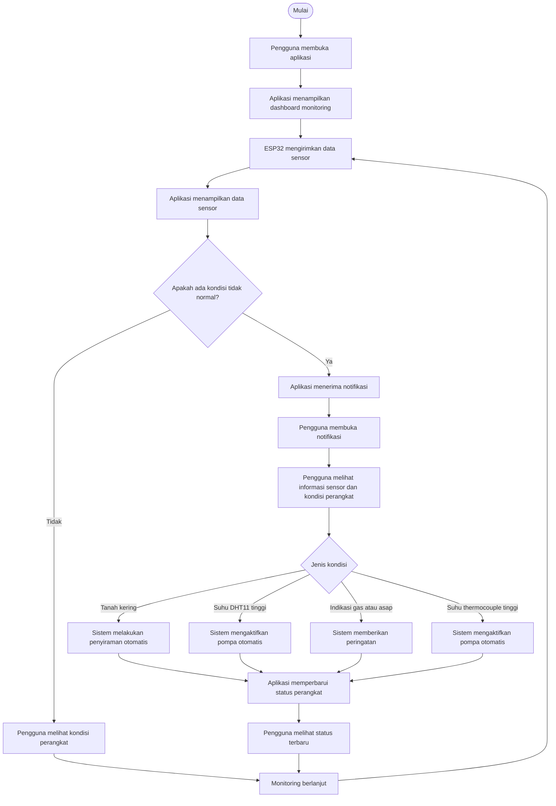

# USER FLOW
## Sistem Monitoring dan Otomatisasi Penyiraman Berbasis IoT

### 1. Deskripsi

User Flow ini menggambarkan alur interaksi pengguna dengan perangkat IoT melalui aplikasi monitoring. Pengguna dapat memantau kondisi lingkungan, menerima notifikasi dari sensor, serta mengetahui aktivitas otomatisasi pompa air.

### 2. Aktor

| Aktor | Peran |
|---|---|
| Pengguna | Memantau kondisi perangkat dan menerima notifikasi melalui aplikasi. |
| ESP32 | Membaca dan memproses data dari seluruh sensor. |
| Aplikasi | Menampilkan data monitoring dan notifikasi perangkat. |

### 3. User Flow Utama

### 4. Alur Interaksi Pengguna

#### 4.1 Membuka Aplikasi
1. Pengguna membuka aplikasi monitoring IoT.
2. Aplikasi menampilkan halaman dashboard.
3. Pengguna dapat melihat kondisi dan data seluruh sensor.

#### 4.2 Monitoring Sensor
1. ESP32 membaca data dari Soil Moisture, DHT11, MQ-2, dan Thermocouple.
2. Data dikirimkan ke aplikasi.
3. Aplikasi menampilkan hasil pembacaan sensor.
4. Pengguna dapat memantau perubahan kondisi lingkungan.

#### 4.3 Menerima Notifikasi Soil Moisture
1. Sensor mendeteksi tanah dalam kondisi kering.
2. ESP32 mengaktifkan relay dan pompa air.
3. Aplikasi menerima notifikasi bahwa tanah kering dan penyiraman otomatis dimulai.
4. Setelah kelembapan mencapai batas yang ditentukan, pompa berhenti.
5. Aplikasi menerima informasi bahwa penyiraman selesai.

#### 4.4 Menerima Notifikasi DHT11
1. DHT11 mendeteksi suhu lingkungan melebihi batas.
2. ESP32 memproses hasil pembacaan.
3. Sistem mengaktifkan relay dan pompa air.
4. Aplikasi mengirimkan notifikasi mengenai suhu tinggi dan aktivitas pompa.

#### 4.5 Menerima Notifikasi MQ-2
1. MQ-2 mendeteksi nilai gas atau asap melewati ambang batas.
2. ESP32 memproses hasil pembacaan.
3. Aplikasi menerima notifikasi peringatan.
4. Pengguna membuka notifikasi untuk melihat informasi kondisi yang terdeteksi.

#### 4.6 Menerima Notifikasi Thermocouple
1. Thermocouple mendeteksi suhu melebihi batas.
2. MAX6675 meneruskan data suhu ke ESP32.
3. ESP32 mengaktifkan relay dan pompa air.
4. Aplikasi menerima notifikasi suhu tinggi dan aktivitas pompa.
5. Setelah kondisi mencapai batas penghentian, pompa berhenti.

### 5. Informasi yang Ditampilkan pada Aplikasi

| No. | Informasi | Sumber |
|---|---|---|
| 1 | Kelembapan tanah | Soil Moisture |
| 2 | Suhu udara | DHT11 |
| 3 | Kelembapan udara | DHT11 |
| 4 | Nilai gas atau asap | MQ-2 |
| 5 | Suhu titik pengukuran | Thermocouple |
| 6 | Status pompa air | Relay dan Water Pump |
| 7 | Riwayat notifikasi | Seluruh sensor |

### 6. Hasil Akhir

Melalui sistem ini, pengguna dapat:
- Memantau kondisi lingkungan secara berkala.
- Mengetahui tingkat kelembapan tanah.
- Mengetahui perubahan suhu lingkungan.
- Menerima peringatan ketika terdeteksi indikasi gas atau asap.
- Mengetahui aktivitas penyiraman otomatis.
- Menerima notifikasi ketika terjadi kondisi yang melewati ambang batas.
